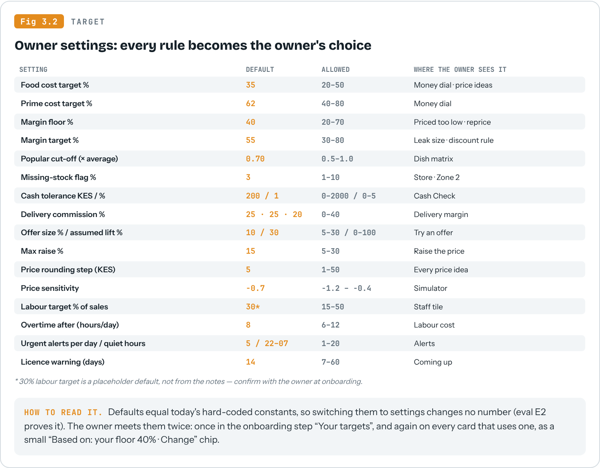
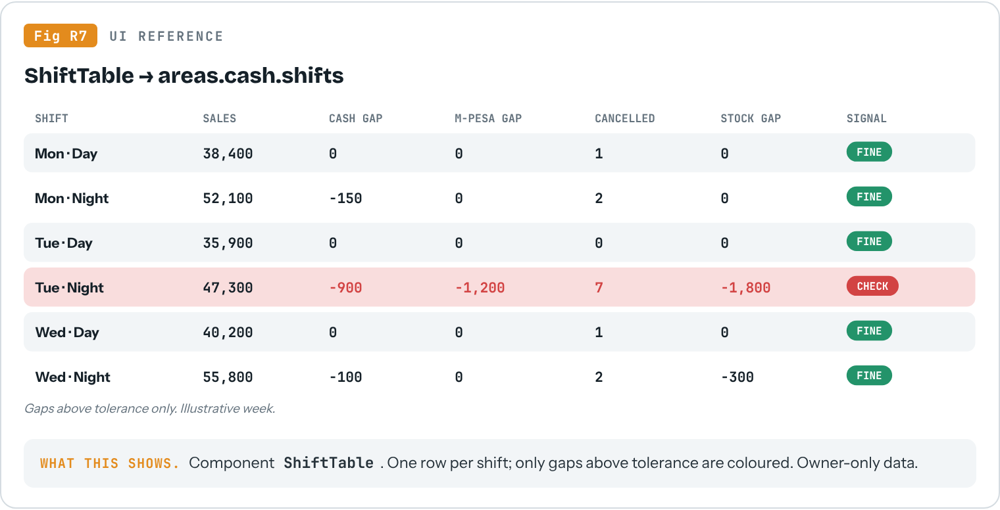

# LEVIII v2 — Build Specification

For: Claude Sonnet 5.5, working autonomously in `wambugumwangi11177-blip/restaurant-agent`.
Author: Mbuguss (LEVIII), with Claude Opus. Written 2026-10-15 against commit `4fe7ae5` (main).

This document is the whole job. Read it once fully before touching code. Everything in section 1 was verified by reading the repository and running its tests; nothing in it is assumed. Where something is a decision or a default rather than a fact, it says so.

---

## 0. Read me first

### 0.1 The mission in one paragraph

LEVIII sits above a restaurant's existing till (POS). It must show an owner where every shilling goes. The engines that compute this already exist in `backend/ai/`, but the owner never sees most of them: there are three separate owner experiences (`/dashboard`, `/vibanda`, `/demo`), the demo runs on its own copy of the maths, Reports only know revenue and top items, and money tracking (expenses, P&L, bills) does not exist yet. **v2 connects everything into one spine**: every source writes rows, every engine reads rows and one settings service, one owner API composes the answers, and one owner shell (Home · OS · Reports) renders them for every tenant, including a demo restaurant that runs on the real engines with rich generated data.

v2 is not a rewrite and not a new repository. It is the same repo, improved in small, proven steps. **Slow is fast.**

### 0.2 How to work (the autonomy contract)

You execute this plan without asking for permission at each step. You plan inside each sprint yourself, but you do not re-plan the phases: the order in section 4 is decided.

**For every sprint, in this order:**
1. Read the sprint card (section 4) and every file it names. Read the code before believing this document; if the code disagrees with section 1, the code wins and you note it in the progress log.
2. Write a short sprint plan at the top of `docs/v2/PROGRESS.md` (goal, files, tests you will add).
3. Implement in the smallest steps that keep the tests green.
4. Run the gate: `make -C docs/v2 gate` (you create it in S0.1; it runs E1 plus the sprint's evals).
5. Update `docs/v2/PROGRESS.md`: what changed, gate output (counts and scores), screenshots paths, anything surprising.
6. Commit with message `v2(Sx.y): <what>` on branch `v2-build`. Push the branch. Never merge to main.

**You may, without asking:** create and edit code, tests, migrations (local SQLite and test DB only), docs under `docs/v2/`, scripts under `execution/`, seed/generator code; install dev dependencies; delete code that this spec marks for deletion once its replacement passes its eval.

**You must never:** run a migration or any write against the production database (`DATABASE_URL` pointing at Neon/Postgres in `.env`), deploy (Railway, Vercel), change provider configuration or secrets, enable paid LLM calls in tests (keep `FEATURE_AI_NARRATION` and creative flags off; mock the client), force-push, rewrite history, delete `directives/`, or delete any tenant's real data.

**Stop and write a STOP note at the top of `PROGRESS.md` (then end the session) only if:** (a) a gate fails three times after genuine fixes, (b) a step would be irreversible or touch production, or (c) the code contradicts this spec in a way that changes money maths. Otherwise keep going: make the most reasonable choice, write down the choice and why, continue.

### 0.3 Rules that apply to every line of code

- **Money is integer cents in the backend** (`Order.total`, `MenuItem.cost_price` are cents). Convert to KES only at the edge. The current `demo_scenario.py` uses integer KES; the replacement must not.
- **Time is Nairobi time for the owner** (UTC+3). Store naive UTC as today; compute windows the way `routers/overview.py::_eat_range` does. Never `func.date()` over UTC columns.
- **Tenant isolation on every query**: resolve `restaurant_id` inside the caller's tenant (`routers/deps.py`, `overview._restaurant_id`). Add a tenant-isolation test for every new endpoint.
- **The LLM never computes a number.** Code computes; the model may only phrase. Every number in model output must exist in the payload (grounding: `ai/reasoning/grounding.py`), or the sentence is dropped.
- **Every number carries its state**: `live` · `as_entered` (with "entered up to <date>") · `learning` (day n of 30) · `not_from_pos` · `stale` (older than 3 days) · `assumption` (with the rule used). The owner never sees an estimate dressed as a fact.
- **Owner words on owner screens** (section 3.4). System words stay in code and inside the "Why?" detail.
- **One source of truth for every threshold**: the settings service (S1.1). No new module-level constants for business rules.
- **Signals, not verdicts.** Fraud and cash findings say "check this", never "this person stole".

---

## 1. What exists today (verified)

Verified 2026-10-15 at commit `4fe7ae5`: backend test suite **880 passed, 1 skipped** (Python 3.13, ~5 min); frontend **vitest 6 files, 55 tests passed** and **`tsc --noEmit` clean** (lint and `next build` not run). CI uses Python 3.12 (`.github/workflows/ci.yml`).


### 1.1 Stack

| Layer | What | Where |
|---|---|---|
| Frontend | Next.js 16.3, React 19.2, Tailwind 4, lucide-react, framer-motion. **No chart library**: charts are hand-built SVG (`components/demo/DemoCharts.tsx`). | `frontend/` (Vercel) |
| API | FastAPI, 31 routers mounted under `/api/v1` (and legacy unprefixed paths) | `backend/main.py`, `backend/routers/` (Railway) |
| DB | Neon Postgres in production; SQLite snapshot `backend/local_dev.db` locally; SQLAlchemy models in `backend/models.py`; Alembic head **050** | `backend/alembic/versions/` |
| Engines | Deterministic Python in `backend/ai/` (profit, pricing, menu, inventory, custody, cash, fraud, KDS, reservations, labour, supply chain, marketing, ROI, simulation/twin, decisions, data quality) | `backend/ai/` |
| LLM | Narration only (grounded), OpenRouter/Groq/Anthropic via `ai/llm_client.py`, spend cap `ai/spend_cap.py` | `backend/ai/` |
| Integration | MacSoft mirror (`integration/`, webhooks), reconcile runs, `observer_mode.py` | Vibanda only |

### 1.2 Three owner experiences, three data paths


`frontend/src/lib/tenantHome.ts` decides the shell by tenant name: "Demo Restaurant" → `/demo`, "Vibanda Village" → `/vibanda`, everyone else → `/dashboard`. There is also a fourth, older fake layer: `frontend/src/lib/demo-data.ts` (hard-coded numbers) used by `/dashboard` and two feature views when `isDemoMode()` and data is empty.

### 1.3 Engine × screen coverage


### 1.4 What each owner surface really shows today

| Surface | Code | Shows | Gaps |
|---|---|---|---|
| Home (`/vibanda`) | `routers/overview.py::today` → `_summarize`, `_stock_card`, `_bookings_card`, `_staff_card`, `_attention_cards` (operational cards + `ai/home_specialists.collect` + `ai/decisions` ranked) , `_performance` (7-day trend) | revenue, orders, avg order, low stock, covers, staff on shift, labour %, attention cards, 7-day trend | `unavailable_metrics` hard-lists pace, kitchen, delayed orders, expiry, waste, waitlist, no-show, overtime. No P&L, no money match, no break-even. Only pricing decisions carry KES (`ai/decisions/adapters.py` docstring). |
| Area pages (`/vibanda/[area]`) | `components/vibanda/VibandaAreaClient.tsx` | title, description, a forecast panel when the source is verified | **Metrics always render "—"** (`EmptyMetric` is used even when live). 20 areas. |
| OS (`/vibanda/os`) | `routers/ai_ask.py` `/ai/chat`, handlers `_answer_stock/revenue/bookings/kitchen/staff/menu/pricing/profit/ops` | deterministic answers for 7 live areas | `lib/osSuggestions.ts::LIVE_ANALYSIS_AREAS` marks suppliers, purchasing, cash, POS, marketing, risk, notifications, intelligence, data-trust, audit, settings as **planned**. No simulator, custody, cash or fraud answers. |
| Reports (`/vibanda/reports`) | `routers/reports.py` `_draft` | revenue, orders, average order, top 5 items + optional creative note | No P&L, food/prime cost, cash, stock, menu, decisions, accountant export. |
| Demo (`/demo`) | `routers/demo.py` → `backend/demo_scenario.py` (56 days, 6 dishes, in-memory) | all 20 areas, reports, PDF, simulator, ideas | Parallel maths; imports **no** engine. Fixes to engines never reach it. |

### 1.5 Verified defects still live in the code

| ID | What | Evidence | Fix in |
|---|---|---|---|
| D1 | Any M-Pesa order marked paid without `mpesa_receipt` becomes a Home card. A POS feed that never carries receipts floods Home. | `ai/fraud/detection.py::_detect_payment_mismatches` (filters `mpesa_receipt IS NULL`), surfaced by `ai/home_specialists.py` "Payment review" | S1.3 |
| D3 | Supplier with 1 delivered order = 100% reliable; the analysis function also **writes** `supplier.reliability_score` during a read. | `ai/supply_chain/intelligence.py::_analyse_supplier` | S1.3 |
| D10 | Overtime cost counts the whole shift's labour cost, not the overtime hours. | `ai/labor/intelligence.py` lines ~58–61 | S1.3 |
| D11 | Business thresholds hard-coded and **duplicated with conflicts**: food-cost ceiling is 35 in `ai/profit/intelligence.py` and `ai/pricing/analysis.py` but 40 in `ai/menu_engineer.py`; delivery commissions defined twice; `margin_pct >= 55` inline in pricing. | grep `HEALTHY_FOOD_COST_MAX`, `MAX_FOOD_COST_PCT`, `FOOD_COST_CEILING_PCT`, `DELIVERY_COMMISSIONS` | S1.1–S1.2 |
| D12 | Holidays hard-coded for 2026 only. | `ai/simulation/signals.py::KENYA_PUBLIC_HOLIDAYS_2026` | S1.3 |
| D16 (new) | Suggested prices round to **KES 0.50**, not a menu-friendly step: `_round_price`/`_round_price_up` divide **cents** by 50. Quarter chicken (cost 260) is suggested at KES 433.50 instead of 435. | `ai/pricing/analysis.py` lines 334–351 (docstring example assumes KES, data is cents) | S1.3 (round to the `price_step_kes` setting, default 5, always up for REPRICE) |
| D15 | "portion_drift" actually measures sales below menu price. | `ai/profit/intelligence.py::_detect_portion_drift` | S1.3 (rename, keep alias) |
| — | Area page metrics are always "—". | `VibandaAreaClient.tsx` | P4 |
| — | `CLAUDE.md` describes a generic scraping template (directives/execution, Google Sheets deliverables) and a `graphify-out/` graph that is not in the repo. | `CLAUDE.md` | S0.1 (append a v2 section; do not delete the existing text) |

### 1.6 Constants verified against the business rules

| Rule | Value in code | File | Matches the agreed rule |
|---|---|---|---|
| Margin floor / target | 40 / 55 | `ai/profit/intelligence.py`, `ai/pricing/analysis.py` | yes |
| Food cost healthy max | 35 (profit, pricing) vs **40** (menu) | see D11 | **conflict** → unify at 35 via settings |
| Popular cut-off | 0.7 × mean | `ai/menu_engineer.py::POPULARITY_INDEX` | yes |
| Raise / slow thresholds | 1.30 / 0.60, 14 days, 5 orders, 7-day cooldown | `ai/pricing/analysis.py` | yes |
| Discount | 10%, only if margin ≥ 55 | `ai/pricing/analysis.py` (inline literal) | yes, but inline |
| Cash tolerance | max(KES 200, 1%) | `ai/cash_reconciliation/intelligence.py` | yes |
| Variance flag | 3% | `ai/stock_custody.py::VARIANCE_THRESHOLD` | yes |
| Decision weights | 0.45 / 0.25 / 0.15 / 0.15 | `ai/decisions/ranking.py` | yes |
| Price sensitivity | −0.7, clamped −1.2…−0.4 | `ai/simulation/engine.py` | yes |
| Forecast growth damping, band | 0.3, ±0.7σ | `ai/revenue_forecaster.py`, `ai/simulation/twin.py` | yes |

---

## 2. Target architecture


**Principles**
1. **One path per number.** Source → rows → engine (+settings) → owner API → shell. Nothing on an owner screen is computed in a router, a page, or a scenario file.
2. **Composition, not rewriting.** The owner API (`backend/owner/`, new) calls existing engine functions and reshapes their output. Engines keep their tests. If an engine is wrong, fix it in the engine.
3. **Strangler pattern.** New paths are added beside old ones, proven equal or better by evals, then the old path is deleted. The order of deletion is in section 4.
4. **Every engine is registered.** `backend/owner/registry.py` lists every engine with: key, owner name, area, Home zone, OS topics, report sections, required inputs, settings it reads. The coverage eval (E5) reads this registry, so nothing can be built and left unwired again.
5. **One owner shell.** `/vibanda` and `/demo` become one `OwnerShell` driven by tenant config (name, source type, branding). `/dashboard` stays for managers and generic tenants until the staff dashboards are designed (P7); owners of every tenant land in the OwnerShell.

**New backend package**

```
backend/owner/
  registry.py        # every engine: key, area, zone, OS topics, report sections, inputs, settings
  settings.py        # get_settings(db, restaurant_id) -> Settings (defaults = today's constants)
  states.py          # data-state labels + freshness, one function used everywhere
  home.py            # compose /owner/home
  areas.py           # compose /owner/area/{key} (same blocks Home expands)
  reports.py         # compose /owner/report/{period}
  ask.py             # thin adapter over routers/ai_ask handlers + simulator + compare
  money/             # P&L, break-even, bill radar, expense spikes (P3)
routers/owner.py     # GET /owner/home, /owner/area/{key}, /owner/report/{period}, POST /owner/ask, GET|PUT /owner/settings
```

---

## 3. Owner experience

### 3.1 Home v2: everything on Home


The owner has three pages: **Home, OS (Ask LEVIII), Reports.** Home carries every engine's output. The six area panels are collapsed to one line each (one number + a status word) and expand in place. Old `/vibanda/[area]` URLs redirect to `/home#area-<key>` with that panel open.

**Home payload contract** (`GET /api/v1/owner/home?period=today|7d|30d`): every block has `state`, `as_of`, and, where a rule was used, `assumption: {setting, value}`.

| Block | Fields | Engine / source | Chart (see 3.3) |
|---|---|---|---|
| pulse | `sales_today`, `vs_same_weekday_pct`, `trend_7d[]`, `breakeven_at`, `money_match {cash, mpesa}`, `freshness` | overview._summarize, revenue_forecaster, owner/money, cash_reconciliation, mpesa match (P6) | bars + chips |
| costing_you_money | top 5 `{id, sentence, kes_month, action, why, assumption, decision}` | ai/decisions (extended to KES for stock gap, cash gap, till gap, delivery gap, leak) | cards |
| health | 6 tiles `{area, number, word, status}` | registry rules | tiles |
| areas.money | P&L lines, food/prime cost %, break-even, bills, spikes | owner/money | waterfall, dials, clock, radar |
| areas.sales_dishes | 7-day, forecast band, matrix, dishes by KES, price ideas, delivery & daypart margins | forecaster, menu_engineer, pricing, profit | bars, band, quadrant, bars |
| areas.store | missing stock (KES), disputes, reorder drafts, supplier card | stock_custody, inventory_predictor, reorder, supply_chain | bars, list |
| areas.cash | per-shift match, cancelled sales, sold below menu price, patterns | cash_reconciliation, fraud, profit | table, grid |
| areas.staff | wages vs sales, sales per staff hour, on shift | labor | dial, bars |
| areas.permits | licences, settings summary, till connection | settings, observer/source status | list |
| coming_up | bills, licences, deliveries, bookings | money, settings, purchase orders, reservations | list |
| read | AI note (optional, grounded) | creative layer | text |

**Ranking rule for "costing you money"** (S4.3): operational facts first (as today), then decisions by KES impact; a decision without an honest KES figure ranks after all quantified ones. Extend `ai/decisions/adapters.py` so stock variance (gap × unit cost), cash gap, till price gap, delivery margin gap and profit leaks (floor-based, not target-based) carry `impact_cents_month`.

### 3.2 Owner settings



- **Model**: `RestaurantSettings` (migration 051): one row per restaurant, typed columns, `updated_by`, `updated_at`; history kept in an audit table.
- **Service**: `owner/settings.py::get_settings(db, rid)` returns defaults when no row exists. Engines take a `settings` argument (default `None` → defaults), so existing callers and tests keep working.
- **Onboarding**: a first-run step "Your targets" shows each setting with a plain sentence ("Out of every KES 100 you sell, how much should ingredients cost at most?") and the default pre-filled.
- **In context**: every card or chart that used a setting shows a chip "Based on: your floor 40% · Change". Tapping opens a sheet with the slider (bounded by the allowed range), a one-line explanation, and a live preview of how many cards would change.
- Settings are owner-only (`require_staff_role` with owner/admin).

### 3.3 Chart kit and visual references

There is no chart library and none is needed. Build `frontend/src/components/charts/` as small, typed SVG components that read theme tokens: `Waterfall`, `Dial` (band + marker), `Bars` (with highlight), `BandForecast`, `Quadrant`, `BreakEvenClock`, `CashRunway` (bill radar), `ShiftTable`, `HeatGrid` (recurring patterns), `StackedBar` (plate economics), `Sparkline`. Each takes data + a `state` and renders an honest empty/learning state itself. The pictures below are the approved look; numbers in them are illustrative.





### 3.4 Owner vocabulary (use exactly)

| System | Owner sees |
|---|---|
| P&L / gross profit / operating profit | Profit & Loss / Left after ingredients / What you kept |
| Break-even | Costs covered |
| Food cost % / prime cost % / labour % | Out of every KES 100, ingredients / ingredients + wages / wages |
| Stock variance / custody / custody dispute | Missing stock / store-to-kitchen handover / handover doesn't match |
| Reorder draft / par level | Time to reorder / full-shelf level |
| Cash reconciliation / M-Pesa match / voids | Cash count check / M-Pesa check / cancelled sales |
| Fraud signals | Things to check |
| Profit leak / till price gap (was portion drift) | Priced too low / sold below menu price |
| Channel margin / daypart margin | What delivery really pays / best and weakest hours |
| Star / Plowhorse / Puzzle / Dog | Best dishes / popular, earns little / earns well, few order it / consider removing |
| Decision ranking / ops health / creative layer | What's costing you money / restaurant health / LEVIII's read |

---

## 4. Phases and sprints


Each sprint card: **Goal · Do · Done when (gate)**. Gates always include E1 (full regression) plus the evals named.

### P0 — Baseline and map

**S0.1 Baseline.** Do: create `docs/v2/` (copy this spec as `SPEC.md`, add `PROGRESS.md`, `Makefile` with targets `test`, `fe`, `evals`, `gate`). Record backend test count, frontend `vitest`, `tsc --noEmit`, `eslint`, `next build` results in `PROGRESS.md`. Append a "v2 build" section to `CLAUDE.md` pointing to `docs/v2/SPEC.md` (keep existing text). Done when: baseline numbers are written and `make gate` reproduces them.

**S0.2 Code map script.** Do: `execution/codemap.py` builds the import graph (Python AST + TS imports) and the engine × surface matrix from code, writing `docs/v2/codemap.json` and `docs/v2/coverage.md`. Done when: it reproduces figure 1.3's rows from code (allowing improvements you discover).

**S0.3 Golden fixtures.** Do: `backend/tests/fixtures/golden_restaurant.py`, a small deterministic restaurant (one week, 8 dishes, recipes, deliveries, counts, a transfer, two drawer counts) whose answers are the worked examples in section 7. Add `tests/evals/test_e2_money_goldens.py` asserting today's engines produce today's numbers. Done when: E2 green on current code (characterisation: it captures behaviour before you change anything).

### P1 — One spine

**S1.1 Settings.** Do: `RestaurantSettings` model + migration 051, `owner/settings.py`, `GET|PUT /api/v1/owner/settings` with bounds validation and audit row. Done when: tenant-isolation and validation tests pass; E1.

**S1.2 Constants → settings.** Do: engines read thresholds from `get_settings` (profit, pricing, menu, cash, custody, simulation, decisions, labour, delivery commissions). Unify the food-cost ceiling at 35. Done when: E2 goldens unchanged (except the documented food-cost unification, updated in the same commit with a note) and a test proves changing a setting changes the engine output.

**S1.3 Defect fixes.** Do: D1 (only flag a missing receipt when the order's source is LEVIII's own M-Pesa STK path; never for POS-fed orders; cap Home cards from one rule at 1 summary card), D3 (no writes in read paths; reliability needs ≥ 3 closed orders else "learning"), D10 (overtime cost = overtime hours × hourly rate), D12 (holidays from a yearly data file `backend/data/ke_holidays_<year>.json`, 2026 and 2027), D15 (rename to `till_price_gap`, keep `portion_drift` key as deprecated alias for one release), D16 (price rounding in KES steps from settings; add a test that cost 26,000 cents suggests 43,500). Done when: a regression test per defect; planted scenarios P15/P16 pass once P2 exists.

**S1.4 Owner API skeleton.** Do: `backend/owner/` + `routers/owner.py` composing existing engines for `home`, `area`, `report` (current content only), `ask` (delegates to `ai_ask`). Add `registry.py` with every engine in figure 1.3. Done when: `/owner/home` returns every block with honest `state` values for a fresh tenant and for the golden fixture; E5 (coverage) runs and reports which registry entries are not yet on a surface (allowed to fail per-entry until P4, but the report must be produced).

### P2 — Demo restaurant on the real engines

**S2.1 Generator.** Do: `backend/demo/generator.py`, deterministic (seed), writing rows through the ORM for the "Demo Restaurant" tenant: 2 branches, 120 days, ~30 dishes with recipes and costs, tables, reservations, staff and shifts, suppliers, purchase orders and deliveries, stock counts, store→kitchen transfers, drawer counts per shift. Idempotent re-seed (`execution/reseed_demo.py`), runs only against local/test DBs unless an explicit `--allow-remote` flag and a typed confirmation. Done when: the demo tenant produces non-empty output from every engine in the registry.

**S2.2 Planted scenarios.** Do: plant P1–P7, P11–P16 (figure 6.1) on top of the baseline distribution. Done when: E4 passes for those scenarios.

**S2.3 /demo on the owner API.** Do: point the demo shell at `/api/v1/owner/*`. Keep `demo_scenario.py` behind `FEATURE_LEGACY_DEMO` until E4 and E6 pass on the new path, then delete `demo_scenario.py`, `routers/demo.py` scenario routes, `lib/demo-data.ts` fallbacks and their tests in one commit. Done when: no import of `demo_scenario` remains; E4, E6 green.

### P3 — Money (door 2)

**S3.1 Expenses and bills.** Do: models `Expense` (category, amount_cents, paid_at, paid_by, method, branch, receipt photo ref), `ExpenseCategory` (Kenyan P&L lines: premises, KPLC, water, garbage, security, gas, charcoal, delivery commissions, M-Pesa and bank charges, POS/internet, licences, repairs, cleaning, packaging, marketing, salaries, casuals, staff meals), `RecurringBill` (amount, due rule, supplier), `Licence` (name, expires_on). Migration 052, CRUD endpoints for manager/accountant roles. Done when: CRUD + tenant isolation tests.

**S3.2 P&L engine.** Do: `owner/money/pnl.py`: revenue (food, drinks, delivery net of commission), cost of sales (recipe cost × items sold, or purchases-based when recipes are missing, flagged), gross profit, labour, operating expenses by line, operating profit, net before tax; food cost %, prime cost %, operating profit %. Day/week/month/year. Missing-cost detection → `as_entered` with the list of missing categories. Done when: E2 asserts the section 7 P&L example exactly.

**S3.3 Break-even, bill radar, expense spikes.** Do: break-even sales = fixed costs per day ÷ (1 − food cost %), time of crossing from live sales; bill radar = forecast sales − bills due, by day for 30 days; expense spike = month vs 3-month average ≥ 25% (setting). Plant P9, P10. Done when: E2 + E4 for P9, P10.

**S3.4 Accountant export.** Do: monthly P&L as XLSX (openpyxl) and PDF (reuse `demo_report_pdf.py` style, generalised). Done when: export opens and its totals equal `/owner/report/monthly`.

### P4 — Home v2

**S4.1 OwnerShell.** Merge `app/vibanda` and `app/demo` into `app/home` + `app/os` + `app/reports` driven by tenant config; `tenantHome.ts` routes owners of every tenant there. Keep `/vibanda/*` and `/demo/*` as redirects. **S4.2** Zones 1–2. **S4.3** Health strip + six area panels (all blocks in 3.1). **S4.4** Zones 4–5. **S4.5** Settings chips + onboarding "Your targets" + guided first week (one area unlocked per day for new tenants, skippable). **S4.6** Mobile pass at 390 px.
Done when (P4 as a whole): E5 passes for every registry entry (every engine on Home and in OS and in at least one report section); E6 passes; no "—" placeholder renders when its block has data; no "planned" label remains on owner screens.

### P5 — OS and Reports

**S5.1** OS answers every area in the five forms: what, why (drivers in order: holiday/event, top-dish stock-out, staffing, void spike), what-if (simulator, with the assumption shown), what should I do (ranked by KES), compare (periods, branches). Remove `LIVE_ANALYSIS_AREAS`/"planned". Plant P12, P14. **S5.2** Reports: daily (control), weekly (performance), monthly (full P&L + export), yearly (trends) with the contents in section 3 of the study notes; creative section optional and dropped if any number is unbacked. **S5.3** Alert levels: now (push, max per day, quiet hours, cash/fraud to owner only, escalation skips managers), today (evening digest), this week (in report).

### P6 — M-Pesa statement (door 3)

**S6.1** Upload endpoint + parser interface. The real M-Pesa business statement format is **unknown**: build `parsers/mpesa_csv.py` against a fixture you design from public format descriptions, behind an interface, and write in `PROGRESS.md` that a real sample is needed. **S6.2** Matching: exact (amount, ±10 min), grouped (several sales = one payment), and both gap directions; plant P8. Done when: E4 for P8; unmatched totals appear in Zone 1 money match.

### P7 — Staff entry screens (outline only; do not build yet)

Storekeeper (receive delivery, issue to kitchen, count), manager (close shift, expenses), accountant (export). Phone-first, pick-from-list, under one minute per entry. Write a design note in `docs/v2/P7.md` from what P1–P6 taught you; stop there.

---

## 5. Evals


| Eval | File | What it proves | Pass |
|---|---|---|---|
| E1 Regression | `make test fe` | nothing that worked broke | 100% of existing tests (baseline 880 backend) + new ones; tsc, lint, build clean |
| E2 Money goldens | `tests/evals/test_e2_money_goldens.py` | the maths is exactly right | every worked example in section 7 equal to the cent |
| E3 Grounding | `tests/evals/test_e3_grounding.py` | AI text never invents a number | 100% of numbers in narrated text appear in the payload; a planted wrong number is dropped |
| E4 Planted scenarios | `tests/evals/test_e4_demo_scenarios.py` | engines find real problems end to end | each scenario in figure 6.1 detected by the named engine and present in the named block |
| E5 Screen coverage | `tests/evals/test_e5_coverage.py` | nothing is built and left invisible | every registry entry appears on Home, is answerable in OS, and is in ≥ 1 report |
| E6 Owner tasks | `frontend/tests/e2e/owner-tasks.spec.ts` (Playwright, 390 px and 1440 px) | an owner can find the answer | "did cash balance", "top money leak", "next bill" each visible within the first screen of Home after load; no console errors; no "—" with data present |

Write each eval before the code it judges (it should fail first, for the right reason). Report eval results as numbers in `PROGRESS.md` every sprint.

---

## 6. Demo restaurant


- **Identity**: tenant "Demo Restaurant" (already `DIRECT_SOURCE_TENANTS` in `routers/overview.py`), two branches ("Westlands", "Kasarani"), owner login from `DEMO_RESTAURANT_OWNER_EMAIL`.
- **Scale**: around KES 100,000 sales per branch per week, so the client guide's examples read naturally.
- **Menu** (~30 dishes) must include: Quarter chicken (KES 400, cost 260), Chips (300, cost 90), Burger (600, cost 280), Nyama choma (Star), Fish fillet (650, cost 260, Puzzle), Spaghetti (Dog), Pilau (350), Beef stew, Fried rice, Chai, fresh juices, sodas, beer and one spirit (counted in tenths).
- **Determinism**: same seed → same rows → same screens. Dates are relative to "today" so the demo never looks stale; planted weekly patterns align to weekdays.
- **Honesty**: every demo screen keeps the existing "Illustrative demo" notice.

---

## 7. Worked examples (all recomputed for this spec)

These are the numbers used in the client guide and video. Each was recomputed in code on 2026-10-15; all arithmetic matches. One example depends on a fix: #3 assumes prices round to KES 5 (D16). Use them as E2 goldens.

| # | Example | Computation | Result |
|---|---|---|---|
| 1 | Weekly P&L | 100,000 − 32,000 = 68,000; 68,000 − 25,000 − 28,000 | gross 68,000 · kept 15,000 (15%) · prime 57% |
| 2 | Price rise +5,000 same plates | food 32,000/105,000; labour 25,000/105,000; opex 28,000/105,000; profit 20,000/105,000 | 30.5% · 23.8% · 26.7% · 19.0% |
| 3 | Quarter chicken to floor | 260 / (1 − 0.40) = 433.3 → round up to the KES 5 step = 435; (435 − 400) × 300 | KES 10,500 / month (today's code says 433.50: D16) |
| 4 | Same dish to 55% target | 260 / 0.45 = 577.8 → 578; (578 − 400) × 300 | KES 53,400 / month (never pitched) |
| 5 | Chips sold below menu | (300 − 270) × 400 × 30 / 14 | KES 25,714 ≈ 25,700 / month |
| 6 | Burger delivery | 600 − 25% (150) − 280 vs 600 − 280 | keeps 170 vs 320 |
| 7 | Beef variance | 50 + 30 − 40 = 40 used; 120 × 0.25 = 30 expected | 10 kg missing (25% > 3%) |
| 8 | Cash tolerance | max(200, 1% × 35,000) = 350; short 520 | flagged |
| 9 | Break-even | 8,000 ÷ (1 − 0.32) | KES 11,765 of sales |
| 10 | Combo | 650 + 550 = 1,200 → 1,050; cost 260 + 200 = 460; (1,050 − 460)/1,050 | 56.2% (above 40% floor) |
| 11 | Prep: stew | 45 × 0.25 kg cooked ÷ 0.80 yield | 14.06 kg raw |
| 12 | Market list | beef 14 + 5 − 8; chicken 60 + 20 − 32; tomatoes 6 + 2 − 1; rice 13.5 + 10 − 25 | 11 kg · 48 · 7 kg · 0 |
| 13 | Monthly P&L | 412,000 − 131,800 = 280,200; − 103,000 − 112,000 | kept 65,200 (15.8%); food 32.0% |
| 14 | Expense spike | (14,600 + 14,100 + 14,300)/3 = 14,333; 18,600 / 14,333 | +29.8% |
| 15 | Decision score | 0.9×45 + 0.6×25 + 0.8×15 + 1.0×15 | 82.5 |
| 16 | KES vs % | 500 × 30% × 1,000 vs 500 × 70% × 10 | 150,000 vs 3,500 |

---

## 8. Kickoff prompt (paste into Claude Code with Sonnet 5.5)

> You are building LEVIII v2 in this repository, autonomously, from `docs/v2/SPEC.md`. Read the whole spec, then read the code it names before believing it.
>
> Before you write the first line of code, answer in `docs/v2/PROGRESS.md`, briefly: (1) what a top engineer would do on a brownfield codebase like this that the spec does not spell out; (2) what raw material you will work from: the code, the tests, `local_dev.db`, not summaries; (3) which methods and tools you will use for each phase; (4) what, other than you or me, will show each sprint is right: name the tests and evals. Then start at S0.1 and execute the sprints in order, following section 0.2 exactly: plan the sprint, build, run the gate, log the evidence, commit on `v2-build`, continue. Do not ask me questions; make the most reasonable choice, write it down, and keep going. Stop only on the three STOP conditions in 0.2.

---

## Appendix A — Files you will touch most

`backend/routers/overview.py` · `backend/ai/home_specialists.py` · `backend/ai/decisions/{adapters,ranking}.py` · `backend/routers/ai_ask.py` · `backend/routers/reports.py` · `backend/routers/demo.py` · `backend/demo_scenario.py` (to delete) · `backend/models.py` · `backend/alembic/versions/` · `backend/ai/{profit,pricing,menu_engineer,stock_custody,cash_reconciliation,fraud,labor,supply_chain,simulation}` · `frontend/src/lib/{tenantHome,vibandaAreas,osSuggestions,demo-data}.ts` · `frontend/src/app/{vibanda,demo}/` · `frontend/src/components/{vibanda,demo,os}/`.

## Appendix B — Open questions (do not block on them)

1. Real M-Pesa business statement export format (P6 needs one real sample).
2. Labour target default (30% placeholder) — confirm with the first owner at onboarding.
3. MacSoft live link and whether its feed carries item-level prices and void staff names (affects price confirmation and void signals).
4. Final product name on screens: "LEVIII" is used here.
